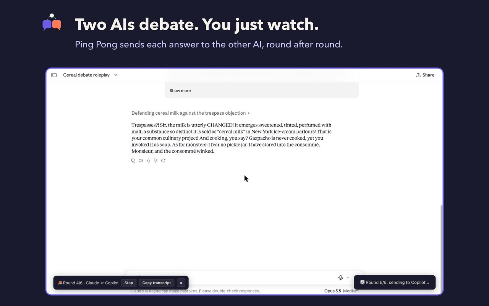
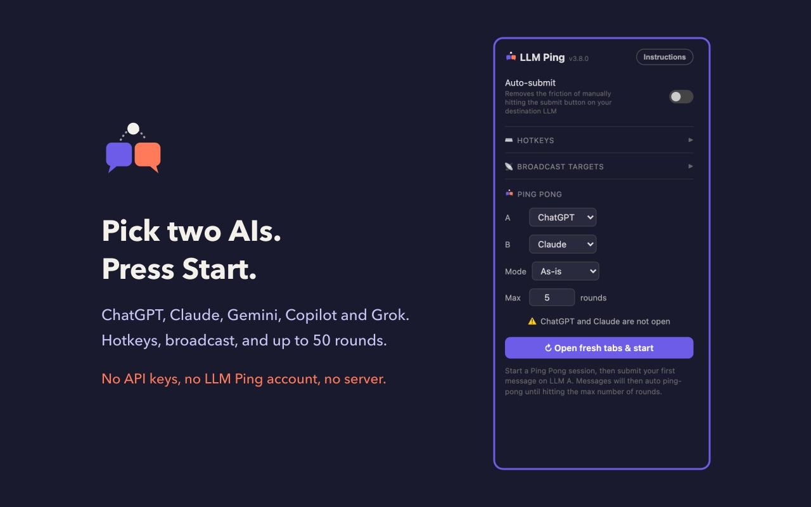

# LLM Ping

**Bounce answers between ChatGPT, Claude, Gemini, Copilot and Grok, or let two AIs debate each other on their own.**

LLM Ping is a Chrome extension. Right-click an AI's answer and send it to another AI in one move, optionally asking it to critique, improve, compare or expand on it. Or open the popup, pick two AIs, press Start, and watch them pass the conversation back and forth for as many rounds as you choose. That's **Ping Pong**.

It works with the normal websites you already use. No API keys, no LLM Ping account, no server.



**User guide:** [ckharrison.net/llm-ping-help.html](https://ckharrison.net/llm-ping-help.html) · **Privacy policy:** [ckharrison.net/llm-ping-privacy.html](https://ckharrison.net/llm-ping-privacy.html)

---

## Contents

- [Features](#features)
- [Supported sites](#supported-sites)
- [Install](#install)
- [Quick start](#quick-start)
- [Using LLM Ping](#using-llm-ping)
- [Ping Pong](#ping-pong)
- [Settings](#settings)
- [Troubleshooting](#troubleshooting)
- [Known limitations](#known-limitations)
- [Privacy and permissions](#privacy-and-permissions)
- [How it works](#how-it-works)
- [Development](#development)
- [Reporting a broken site](#reporting-a-broken-site)
- [Version](#version)
- [License](#license)

---

## Features

| Feature | What it does |
|---|---|
| **Right-click send** | Send the latest answer on the page to another AI. |
| **Send a selection** | Highlight part of an answer and send only that. |
| **Modify** | Wrap the answer in an instruction: ask the next AI to critique, improve, compare or expand on it. |
| **Broadcast** | Send to every AI you've switched on, at once. |
| **Hotkeys** | <kbd>Ctrl</kbd>+<kbd>Shift</kbd>+<kbd>1</kbd> to <kbd>5</kbd> for each AI, <kbd>0</kbd> for all. Reassignable. |
| **Auto-submit** | Optionally send straight away instead of waiting for you to press Enter. |
| **Ping Pong** | Two AIs hold a conversation by themselves, 1 to 50 rounds, in any of the five modes. |
| **Fresh-chat check** | Before Ping Pong starts, it checks both AIs are open on new chats and offers to open them. |
| **In-page controls** | A round counter, Stop and Copy transcript on both tabs, so the popup can stay closed. |
| **Copy transcript** | The whole Ping Pong exchange as Markdown, during or after the session. |
| **Fails loudly** | A session that can't continue stops and says why, instead of sitting on a round number that never moves. |

## Supported sites

| AI | Website | Hotkey |
|---|---|---|
| Claude | claude.ai | <kbd>Ctrl</kbd>+<kbd>Shift</kbd>+<kbd>1</kbd> |
| ChatGPT | chatgpt.com | <kbd>Ctrl</kbd>+<kbd>Shift</kbd>+<kbd>2</kbd> |
| Gemini | gemini.google.com | <kbd>Ctrl</kbd>+<kbd>Shift</kbd>+<kbd>3</kbd> |
| Copilot | copilot.com | <kbd>Ctrl</kbd>+<kbd>Shift</kbd>+<kbd>4</kbd> |
| Grok | grok.com | <kbd>Ctrl</kbd>+<kbd>Shift</kbd>+<kbd>5</kbd> |
| All enabled AIs | | <kbd>Ctrl</kbd>+<kbd>Shift</kbd>+<kbd>0</kbd> |

On a Mac the hotkeys use the **Control** key, not Command.

All five were last verified against the live, signed-in sites on 2 November 2026 (version 3.8.0). These sites redesign without notice; see [Reporting a broken site](#reporting-a-broken-site).

## Install

LLM Ping is not on the Chrome Web Store. It installs straight from GitHub, using Chrome's own **Load unpacked** option.

1. Go to the [latest release](https://github.com/ck-harrison/llm-ping/releases/latest) and download `llm-ping-<version>.zip` (under **Assets**).
2. Unzip it, and put the folder somewhere it can stay. Chrome loads the extension from that folder every time it starts, so don't delete it.
3. Open `chrome://extensions` in Chrome.
4. Turn on **Developer mode** (top right).
5. Click **Load unpacked** and choose the unzipped folder (the one containing `manifest.json`).
6. Pin LLM Ping: click the puzzle-piece icon in the toolbar, then the pin next to LLM Ping.
7. **Reload any AI tabs that were already open.** A tab only gets the extension when it loads.

Or clone the repository and load its folder the same way. The whole repository loads as-is; there is no build step.

**Updating:** download the new release, replace the folder's contents with it, then click the reload arrow on the LLM Ping card at `chrome://extensions` and reload your AI tabs. Your settings are kept. Chrome does not update unpacked extensions on its own; watch the repository's releases to hear about new versions.

Requires Chrome 102 or later.

## Quick start

1. Sign in to two of the supported AIs in separate tabs, as you normally would.
2. Ask one of them a question.
3. Right-click anywhere on that page, choose **LLM Ping**, then **➡** the other AI.
4. LLM Ping switches to that tab and puts the answer in its message box. Press Enter.

To let them talk by themselves, see [Ping Pong](#ping-pong).

## Using LLM Ping

### Send an answer

Right-click on any of the five AI sites and choose **LLM Ping → ➡ *AI name***. LLM Ping takes the latest answer on the page, switches to the target AI's tab (preferring one in the same window, and opening one if there isn't any), and puts the text in its message box.

To send only part of an answer, **highlight it first**, then right-click it.

The hotkeys do the same thing. Click on the AI's page first: they only fire while one of the AI sites has focus.

### Modify: ask for something specific

**LLM Ping → 🔄 Modify → *instruction* → ➡ *AI name*** wraps the answer in one of these instructions before sending it:

| Mode | The other AI is asked to |
|---|---|
| Ask to critique | identify weaknesses, missing nuance or errors, and suggest improvements |
| Ask to improve | rewrite it, keeping the intent but making it stronger, clearer and more accurate |
| Ask to compare | answer the same question independently, then compare the two answers |
| Ask to expand | add depth, examples and anything important that was missed |

### Broadcast

**LLM Ping → 📡 Broadcast → *mode*** sends to every AI switched on under **Broadcast targets** in the popup, except the one you're on. <kbd>Ctrl</kbd>+<kbd>Shift</kbd>+<kbd>0</kbd> broadcasts as-is. AIs without an open tab get one.

## Ping Pong

Ping Pong passes each answer from one AI to the other, round after round, without you copying anything.



1. Click the LLM Ping icon to open the popup.
2. Under **Ping Pong**, choose **A** and **B**. A speaks first.
3. Choose a **Mode**: *As-is*, or one of the Modify instructions, applied to every round.
4. Set **Max rounds** (1 to 50, default 5).
5. Press **Start Ping Pong**. LLM Ping checks both AIs first:
   - both open on new chats: it starts;
   - one missing or mid-conversation: **Open fresh tabs & start** opens new chats and starts on them;
   - **Start on the existing chats** overrides the check.
6. **Go to A's tab and send your opening message.** Nothing happens until you do.

A bar appears at the **bottom left of both tabs** with the round counter, **Stop** and **Copy transcript**. Ping Pong always sends each message itself, regardless of the Auto-submit setting.

**Rounds.** One round is one answer passed across. With 6 rounds the conversation crosses over six times and A has the last word, so the transcript holds 7 answers.

**Prompting.** B never sees your opening message, only what A writes. If B should play a role, have A set it up. For example:

> Let's have a live debate with another AI. Motion: 'Cereal is a soup.' You argue FOR the motion, in character as a pompous, slightly unhinged Victorian barrister. Your opponent is a furious French food critic who argues AGAINST. Rules: every turn under 70 words, stay in character, rebut the last point directly, no lists, no headings. Start your first turn by addressing the critic and telling them their role, then make your opening argument.

For serious work, try **Ask to critique** first: each AI picks the other's answer apart instead of agreeing with it.

**When a session stops**, the bar and the popup say why:

| Reason | Detail |
|---|---|
| Round limit reached | The normal end. |
| You pressed Stop | On either tab or in the popup. |
| A tab was closed or lost | Or LLM Ping lost contact with it five times in a row. |
| A message could not be sent | The target's message box stayed empty after filling it. |
| No activity for 3 minutes | Nothing changed on either page: no growing text, no "still writing" indicator, no new message. The message names the AI that went quiet. |
| An AI repeated itself | The same answer twice in a row usually means it isn't receiving messages. |
| Three unusable answers in a row | Duplicates, LLM Ping's own message echoed back, or nothing readable. |

**Transcript.** Copy transcript gives you every answer, numbered and labelled, as Markdown. Your opening message isn't included, because LLM Ping never reads what you type, and the transcript says so. It's kept until you press Start again or close Chrome. Very long sessions stop recording at 500,000 characters, and the transcript is marked INCOMPLETE.

## Settings

All in the popup.

- **Auto-submit** (off by default): send right-click, hotkey and broadcast messages immediately instead of leaving them for you to check.
- **Hotkeys**: click a combination, then press the new one. A clash between two actions is flagged; only the first would fire.
- **Broadcast targets**: which AIs a broadcast reaches.

The popup header shows the running version.

## Troubleshooting

| Symptom | Fix |
|---|---|
| A hotkey does nothing | Click on the AI page first. On a Mac use Control, not Command. Check the popup for a hotkey clash. |
| "Copied to clipboard. Paste it into the chat" | LLM Ping couldn't fill that site's message box and copied the text instead. Paste it yourself. |
| Nothing works on a tab after installing or updating | Reload the tab. |
| The popup asks you to reload the extension | Reload it at `chrome://extensions`, then reload the AI tabs. |
| Ping Pong stopped with "no progress" | That AI is waiting on something: a sign-in prompt, a usage limit, or Grok asking you to pick between two replies. |
| A whole site stopped working | It has probably redesigned. See [Reporting a broken site](#reporting-a-broken-site). |

The [user guide](https://ckharrison.net/llm-ping-help.html) has more detail.

## Known limitations

- **Very short replies** of one or two characters ("OK") aren't recognised as answers, so a session can stall on them.
- **Grok** shows nothing while it is still writing, so LLM Ping waits for its text to stop changing. Short Grok replies take about 25 seconds to pass on, and a pause of more than 4 seconds mid-answer can pass on an unfinished answer. Every other site reports when it's still writing.
- **Grok brings its window to the front** during Ping Pong. Its message box only accepts text while the page has focus.
- **Grok's "choose your preferred response"** needs you to pick one. Until you do, the session waits, and stops after 3 minutes.
- **Hotkeys** only work while an AI page has focus. This is the trade-off for supporting six reassignable hotkeys; Chrome's own shortcut system allows four and can't read the page.
- **Selectors break when sites redesign.** No automated test can catch that; it takes a person on the live sites.

## Privacy and permissions

LLM Ping has no server, no analytics and no tracking, and collects nothing. It reads AI answers on the five supported sites and pastes them into another of those sites when you ask it to. That text goes only to the AI services you already have open.

- **Preferences** (hotkeys, rounds, chosen AIs, broadcast targets) are kept in Chrome's sync storage, which Chrome copies between your own signed-in browsers if Chrome sync is on. No conversation text is stored there.
- **A running Ping Pong session** and its transcript are held in Chrome's session storage on your device, cleared when the browser closes.
- **The clipboard** is written only when you press Copy transcript, or when sending fails and LLM Ping copies the text for you to paste.

| Permission | Why |
|---|---|
| Access to the five AI sites | Read answers and fill the message box. No other site is touched. |
| `contextMenus` | The right-click menu. |
| `storage` | Preferences, and keeping a session alive if Chrome restarts the extension's background worker. |
| `scripting` | Reach an AI tab that was open before the extension was installed or updated. |
| `clipboardWrite` | Copy transcript, and the copy fallback. |

LLM Ping does not ask for the `tabs` permission, so Chrome shows no "read your browsing history" warning.

Full policy: [ckharrison.net/llm-ping-privacy.html](https://ckharrison.net/llm-ping-privacy.html)

## How it works

Plain JavaScript, Manifest V3, no build step, no dependencies.

| File | Role |
|---|---|
| `manifest.json` | Permissions, host list, content-script registration. |
| `shared.js` | Pure logic with no Chrome APIs and no DOM: text cleaning, the modes, the Ping Pong state machine, round accounting, transcript formatting. Loaded by the worker, the content script, the popup and the tests. |
| `background.js` | Service worker: right-click menu, tab routing, Ping Pong orchestration and polling, the stall watchdog. |
| `content.js` | Runs on each AI page: fills the message box, reads answers, hotkeys, the in-page bar and notices. |
| `popup.html`, `popup.js` | The popup: Ping Pong controls and settings. |
| `toast.css` | Styling for the in-page notices and the Ping Pong bar. |
| `icons/icon.svg` | Source of the icon. `scripts/make-icons.sh` renders the PNGs. |

**Detecting a finished answer.** The background worker polls both Ping Pong tabs once a second (polling from the worker is immune to background-tab throttling). Each tab moves through `idle → streaming → cooldown → complete`: an answer is complete once its text has stopped changing for 4 seconds and the site no longer shows a "stop generating" control. The state machine lives in `shared.js` so it can be tested without a browser.

**Filling a message box.** Each site uses a different editor, so each has its own method:

| Site | Editor | Method |
|---|---|---|
| Claude | ProseMirror | Replace the contents with a paragraph and fire an input event. |
| ChatGPT | ProseMirror | The same. |
| Gemini | Quill | The same. |
| Copilot | Lexical | A synthetic paste, after the editor has registered the selection. |
| Grok | tiptap | A synthetic paste, the same way. |

After filling, LLM Ping reads the box back. If it's empty, the send fails loudly instead of sending nothing.

## Development

**You need:** Chrome, Node.js 18 or later, and for re-rendering the icon, `rsvg-convert` (`brew install librsvg`).

```bash
node scripts/gate.js           # the quality gate: run before calling anything done
node --test                    # unit tests only
bash scripts/canary.sh         # proves every gate check can still fail
node scripts/browser-check.js  # installs the extension in a real headless Chrome and checks it (~25 s)
bash scripts/package.sh        # builds llm-ping-<version>.zip, the file attached to each GitHub release
bash scripts/make-icons.sh     # re-renders the icon PNGs from icons/icon.svg
```

**Testing in layers.** Each one catches what the one before can't:

1. **Unit tests** (`tests/shared.test.js`, `tests/boot.test.js`): the pure logic, plus the worker and content script evaluated against stubbed Chrome APIs.
2. **The gate**: 13 mechanical checks, including that the five AIs are registered identically everywhere, that the stall watchdog is wired to real page activity, and that the package can't include internal files. Each check prints what it examined and what it doesn't prove.
3. **Canaries**: plant each check's own violation and confirm it fails, so a check nobody has seen fail can't pass silently.
4. **Real Chrome**: install into a throwaway profile and check what Chrome reports. It has no logins, so it stops at the AI sites.
5. **A person on the live sites.** After any change to selectors or injection, or whenever a site redesigns: with Auto-submit off, use the hotkeys to send around a ring (Claude → ChatGPT → Gemini → Copilot → Grok → Claude) and check each message box, then run one Ping Pong session.

**Reloading during development.** The popup is read from disk every time it opens, but the background worker stays in memory. After editing, reload the extension at `chrome://extensions` **and** reload the AI tabs. The popup header shows the running version: check it first when behaviour doesn't match the code.

**Adding a sixth AI.** Add it to `TARGETS` in `background.js` and `popup.js`, `MESSAGE_SELECTORS`, `COMPOSER_SELECTORS` and `DEFAULT_HOTKEYS` in `content.js`, `DEFAULT_HOTKEYS` in `popup.js`, an injection function and send-button selectors in `content.js`, `CHAT_URL_PATTERNS` in `shared.js`, and the host to `host_permissions`, `content_scripts.matches` and `MENU_URL_PATTERNS`. The gate fails until every one is done.

**Conventions.** Every console line starts with `[LLM Ping]`. No empty `catch` blocks. Pure logic goes in `shared.js`. Raw colours only in `popup.html` and `toast.css`. The version in `manifest.json` must match this README and each JS file's header; the gate checks it.

## Reporting a broken site

When an AI site redesigns, LLM Ping can stop finding its message box or its answers on that site. Please open an issue, or email [contact@ckharrison.net](mailto:contact@ckharrison.net), with:

- which site, and whether you were sending one answer or running Ping Pong;
- the message LLM Ping showed, if any;
- the lines starting `[LLM Ping]` from the page's console (right-click the page, Inspect, Console).

## Version

3.8.1

## License

MIT. See `LICENSE`.
